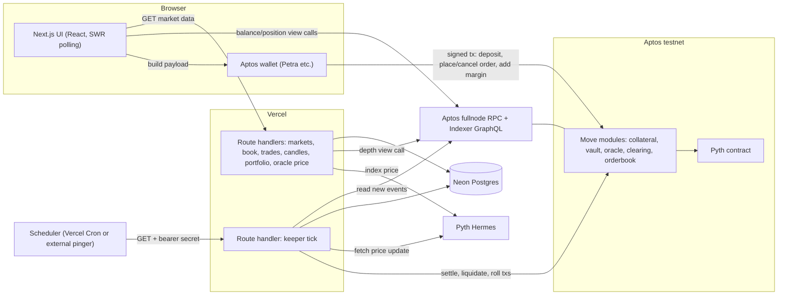

# Zero Day Futures Contracts — Architecture

Source: PS #2 architecture plan, adapted 2026-10-10. This is the living reference for the whole
project. The granular contracts that every module must agree on (units, events, abort codes,
business rules, entry points) are split out into `docs/spec/` so they can be read on their own.

## Section 1: Problem Understanding

**PS #2, in short:**
- A decentralized, non-custodial futures exchange on Aptos. The core product is futures that
  expire in 24 hours, with a design that later allows n-day expiries.
- Users keep ownership of their funds. The platform only acts on them through smart-contract rules.
- At expiry, all trades, profits and losses settle through smart contracts.
- It must offer several contracts, with a **Market Data API** (price, volume, order-book depth per
  contract) and a **Transaction API** (buy/sell, margin calls, settlement).
- **Automated liquidation** closes positions that fall below margin requirements.
- Evaluation weights: Aptos utilization 30%, technical merit 20%, completeness 20%, future
  potential 20%, presentation 10%. Submission needs a hosted or locally runnable project plus a
  README.

**Explicit requirements**
- Non-custodial.
- 24h expiry, with a design that extends to n-day.
- Settlement by smart contract at expiry.
- Several contracts.
- Market data (price, volume, depth).
- Transaction handling (trade, margin call, settlement).
- Automated liquidation.

**Assumptions** (left open by the problem statement):
- **Network and collateral:** Aptos **testnet**, with a mock USDC collateral token that has a
  faucet.
- **Underlyings:** BTC/USD, ETH/USD and APT/USD, each priced from Pyth.
- **Contract type:** linear, USD-margined, cash-settled. The settlement price is the Pyth price
  just after expiry. There is no funding rate, because dated futures converge at expiry.
- **Order book:** an on-chain limit order book (CLOB), so depth is real and trading is
  non-custodial.
- **Margin:** isolated margin per position, with max 10x leverage.
- **"Transaction API":** because the platform is non-custodial, this means wallet-signed on-chain
  entry functions plus a typed client library, not server endpoints that move funds.
- **"Instant settlement":** a permissionless `settle` that a keeper runs within seconds of expiry.
  Any user can also trigger it.

**Mandatory vs optional**

| Mandatory | Optional enhancements |
|---|---|
| Vault (deposit/withdraw), series lifecycle, order book, positions, margin, liquidation, settlement, market-data API, trading UI, keeper | n-day series UI, sponsored (gasless) transactions, Keyless login, Move Prover specs, auto-deleveraging, fees |

## Section 2: Technology Stack

| Layer | Selection | Responsibility | Reason |
|---|---|---|---|
| Smart contracts | Move on Aptos testnet; Fungible Asset standard; `BigOrderedMap` | Custody, order book, margin, liquidation, settlement | Core of the 30% Aptos score |
| Oracle | Pyth Core on Aptos, plus `@pythnetwork/hermes-client` (server-side only) | Index price for liquidation and settlement | Native Aptos integration |
| Frontend | Next.js (App Router) + TypeScript | UI and API in one deployable | Native Vercel support |
| UI/styling | Tailwind + shadcn/ui; `lightweight-charts` | Trade, portfolio and market screens | Fast to build |
| Data fetching | SWR with 2-3s polling | "Real-time" market data | Vercel has no persistent WebSockets |
| Wallet | `@aptos-labs/wallet-adapter-react` | Connect Petra and other standard wallets, sign and submit | Official adapter |
| Chain SDK | `@aptos-labs/ts-sdk` (v2) | Payload building, view calls, tx waiting, keeper signing | Official SDK, paired with adapter v4+ |
| API layer | Next.js Route Handlers (serverless), zod validation | Market data, portfolio, oracle price proxy, keeper tick | No separate backend |
| Database | Neon Postgres (Vercel Marketplace) + Drizzle ORM | Indexed events, history, volume, candles, keeper cursor | Serverless-friendly; branch-per-preview |
| Event source | Aptos Indexer GraphQL (Geomi API key) | Feed module events to the DB | Avoids running a node or indexer |
| Scheduler | Vercel Cron (Pro), otherwise an external pinger such as cron-job.org | Trigger keeper ticks | See Section 9 |
| Hosting | Vercel | Everything except chain and DB | Mandatory |

No auth system or file storage is needed. Wallet signatures are the identity, and there are no
uploads.

## Section 3: High-Level System Architecture



**Component responsibilities**
- **Move modules:** the only place money moves and the source of truth for orders, positions,
  margin and settlement.
- **Wallet + UI:** the UI builds payloads and the wallet signs and submits. The server never
  touches user funds.
- **Market-data routes:** serve DB-derived data (trades, volume, candles, history) and
  chain-derived data (depth, via a Move view function, cached a few seconds at the CDN).
- **Keeper tick:** a stateless, idempotent job that ingests events into the DB, then performs
  permissionless duties (roll series, settle expired series, liquidate).
- **Postgres:** a derived cache of chain events. It can always be rebuilt from the chain.
- **Pyth/Hermes:** supply index prices. Hermes is called server-side only.

## Section 4: Core Application Modules

| # | Module | Purpose | Consumes -> Produces | Talks to |
|---|---|---|---|---|
| M1 | **Move package** (`contracts/`) | `collateral`: mock USDC + capped faucet. `vault`: custody, free balance, margin locks, insurance fund. `oracle`: wrapper over Pyth. `clearing`: series registry, positions, PnL, add_margin, liquidate, settle. `order_book`/`matching`: per-series bid/ask books, price-time matching. `config`: constants + admin capability | Wallet/keeper txs -> state + events | Pyth, Aptos framework |
| M2 | **Chain client** (`lib/chain`) | Payload builders for every entry function, view readers, Move abort-code -> message map, tx lifecycle helper | UI/keeper calls -> payloads/results | M1, RPC |
| M3 | **Event sync** (`lib/sync`) | Pull events after the stored cursor, upsert into DB idempotently | Indexer events -> DB rows | RPC, DB |
| M4 | **Market-data & portfolio API** (`app/api`) | Read-only endpoints, validation, caching | DB + view calls + Hermes -> JSON | DB, M2, Hermes |
| M5 | **Keeper** (`lib/keeper`) | Roll series, settle expired series, scan and liquidate under-margined positions | DB + Hermes price -> txs | M2, M3, DB |
| M6 | **Web UI** (`app/` pages, `components/`) | Markets list, trade screen, portfolio, deposit/withdraw/faucet | API JSON + wallet | M2, M4 |

M2-M6 depend only on the Move **entry-function and event contracts** (see `docs/spec/`), never on
each other's internals.

## Section 5: Database Architecture

**Blockchain state is authoritative** for balances, orders, positions and settlement. **The DB is
derived** and holds only what the chain can't serve efficiently: history, aggregates and lists.
Order-entry numbers (free balance, margin) are read from the chain, not the DB.

| Table | Purpose | Key fields | PK / constraints / indexes | Written by -> Read by |
|---|---|---|---|---|
| `series` | Listed contracts | series_id, underlying, pyth_feed_id, expiry_ts, status (`active`/`expired`/`settled`), settlement_price, created_version | PK series_id; index (status, expiry_ts) | sync -> API, keeper |
| `orders` | Order lifecycle mirror | order_id, series_id, trader, side, price, size, remaining, tif (`gtc`/`ioc`), reduce_only, status (`open`/`partial`/`filled`/`cancelled`), updated_version | PK order_id; index (trader, status), (series_id, status) | sync -> portfolio API |
| `trades` | Executed fills | tx_version, event_index, series_id, price, size, taker, maker, taker_side, ts | PK (tx_version, event_index); index (series_id, ts desc) | sync -> trades, candles, volume |
| `positions` | Latest position snapshot per trader per series | series_id, trader, side, size, entry_price, margin, realized_pnl, status (`open`/`closed`/`liquidated`/`settled`), updated_version | PK (series_id, trader); partial index on status=`open` | sync -> keeper (liquidation scan), portfolio |
| `account_events` | Deposits, withdrawals, liquidations, settlements, faucet | tx_version, event_index, trader, kind, amount, series_id (null), ts | PK (tx_version, event_index); index (trader, ts desc) | sync -> history |
| `sync_state` | Cursor and keeper lease | key, last_version, lease_until | PK key | sync, keeper |

Candles and 24h volume are computed in SQL from `trades`, so there is no candle table. Every
ingest write uses the event's `(version, index)` as an idempotency key. Aptos has instant
finality, so no reorg handling is needed.

## Section 6: API Architecture

See `docs/spec/entry-points.md` for the full off-chain HTTP endpoint table and the on-chain entry
function table (the "Transaction API"). Market orders are IOC limit orders priced at a slippage
bound; only limit orders exist on-chain.

## Section 7: Critical User Flows

**1. Onboard and deposit** — connect wallet, check gas, `faucet_mint`, `deposit`, re-read
`get_balance` from chain after the tx lands.

**2. Place a trade** — ticket computes required initial margin and checks it against on-chain free
balance; wallet signs `place_order`; contract locks margin, matches, emits `OrderPlaced` /
`TradeExecuted` / `PositionUpdated`; next sync tick (or lazy read-through) updates the DB; Move
aborts map to readable messages.

**3. Margin health and margin call** — UI computes equity and health ratio from the position
snapshot plus index price (`lib/math`); below 1.5x maintenance margin it shows a margin-call
banner with "Add margin" calling `add_margin`.

**4. Automated liquidation** — each tick the keeper pulls open positions + latest Hermes prices,
computes equity vs. maintenance margin (5%), submits `liquidate` with the price-update payload for
breached positions. The contract re-verifies on-chain and aborts if the position is healthy. The
position closes at index price against the insurance-fund backstop account; a 1% penalty goes to
the fund. A duplicate or late liquidation aborts harmlessly.

**5. Expiry and settlement** — at expiry the series stops accepting orders (cancels still allowed).
The keeper calls `settle_positions` with a Hermes update at/after expiry; the first call records
the settlement price. Each listed trader's PnL is computed from entry vs. settlement price; margin
plus PnL (floored at 0) returns to free balance, shortfalls draw from the insurance fund. The
keeper repeats in batches of <=25 traders. `roll_series` opens the next 24h series. The contract
never iterates over all positions — the keeper supplies address lists from the DB.

**6. Withdraw** — `withdraw` moves only free balance, never margin locked in orders or positions.

## Section 8: Security and Reliability

| Concern | Mechanism |
|---|---|
| Non-custody | Funds sit in a module-controlled store whose signer capability exists only inside the module |
| Authorization | Admin functions require an admin capability held by a local key. Keeper functions are permissionless but validate all conditions on-chain |
| Oracle integrity | Prices used only inside `liquidate`/`settle`, with the Pyth update passed in the same tx. Stale prices rejected; settlement rejects prices published before expiry. Trading itself is oracle-free |
| Arithmetic | Fixed-point integers with wide intermediates for notional math. Move aborts on overflow |
| Gas/DoS bounds | Caps on open orders per account per series, fills per `place_order`, and batch size per settle |
| Self-trade | Aborts rather than matching |
| Client manipulation | The UI never computes anything the contract does not re-verify |
| Duplicate/retry | UI disables submit until tx result returns; Aptos sequence numbers block duplicate submission; keeper holds a DB lease |
| API abuse | Read endpoints are public and CDN-cached. Zod validates addresses and ids. A Vercel Firewall rate-limit rule covers `/api/*` |
| Secrets | Keeper key, Pyth key, Indexer key, `CRON_SECRET`, `DATABASE_URL` are server env vars only. Browser gets only `NEXT_PUBLIC_*` values |
| Error handling | Structured logs per tick: counts of synced events, settled, liquidated and failed items. `/api/health` exposes sync lag |

## Section 9: Deployment Architecture on Vercel

- **On Vercel:** the Next.js app (static/SSR pages and all route handlers), including the keeper
  tick as a serverless function.
- **Off Vercel (justified):** the Aptos chain and Pyth; Neon Postgres (no local disk); Geomi for
  Indexer access.
- **Move deployment:** contracts published once to testnet from a local machine with the admin
  key; the module address goes into env vars.
- **Environments:** local uses a dev DB + testnet deployment; preview uses a Neon branch DB +
  separate module deployment; production uses the main DB + production module address.

**Verified constraints that shape the design**
- Vercel Hobby cron jobs run once per day; Pro allows per-minute runs. The tick endpoint is the
  same either way — on Pro use Vercel Cron every minute, on Hobby use an external pinger (e.g.
  cron-job.org) hitting the same endpoint with the bearer secret.
- Cron runs can occasionally fire twice or overlap — the tick uses a DB lease and is idempotent.
- **Free-tier lazy sync:** market-data routes call a throttled `syncIfStale` helper sharing the
  same lease, so UI data stays fresh without a tight cron. Liquidation/settlement still depend on
  the scheduler.
- Pyth requires an API key for Hermes calls. The key lives server-side; the browser reads index
  prices only through `/api/oracle/price`, and the keeper fetches update payloads directly.
- Pyth on Aptos needs a price-update argument passed into the contract call, plus an update fee
  paid in APT by the keeper wallet. Always take the current Pyth Aptos contract address from
  Pyth's address page, not from memory.
- **No WebSockets:** "real time" is 2-3s polling plus CDN caching.
- **Function duration:** cap settlements/liquidations/event pages per tick; the next tick resumes
  from the DB.
- **Fallback:** if Pyth access fails on testnet, keep the same `oracle` module interface and feed
  it from a keeper-posted price. Everything else stays unchanged.

## Section 10: Implementation Blueprint

See the repo tree itself for the folder structure (it mirrors `docs/spec/` and this document
exactly — `contracts/`, `src/app`, `src/components`, `src/lib/*`, `scripts/`, `tests/`,
`drizzle/`).

**Import direction (keep this fixed):**
```
pages -> components -> hooks -> (fetch /api) or lib/chain (wallet + views)
api routes -> lib/api, lib/db, lib/chain/views, lib/oracle, lib/sync
keeper -> lib/chain, lib/db, lib/oracle, lib/sync, lib/math
lib/math -> nothing
lib/db -> nothing from chain/keeper
```

Nothing under `lib/` imports from `components/` or `app/`, and routes never contain business
logic.

**Build order**
1. Move: config -> collateral -> vault -> clearing (series, positions, add_margin) -> orderbook ->
   oracle -> liquidate/settle -> unit tests.
2. Testnet deploy and seed series.
3. `lib/chain`.
4. DB schema and `lib/sync`.
5. Market-data API.
6. Wallet connect, faucet, deposit, withdraw UI.
7. Trade UI (book, ticket, chart).
8. Portfolio and margin health.
9. Keeper and scheduler.
10. Deploy to Vercel and run the E2E script.

**Minimal testing strategy**
- **Move unit tests** for: matching and partial fills, margin lock/release, PnL for long and
  short, liquidation threshold boundaries, settlement and insurance-fund shortfall, expiry
  rejection, and access control.
- **Vitest** for `lib/math`, event-to-row mapping (idempotent on replay), and API validation.
- **Scripted testnet E2E** (two accounts): faucet + deposit both; cross orders to create a
  position, check book/trades/DB; trigger liquidation and settlement via a short-expiry admin
  series; check final balances and withdraw.

**Acceptance criteria**
- Deployed on Vercel, with the Move package live on testnet and a working wallet connection.
- A user can faucet, deposit, place and cancel limit and IOC orders, and see live depth, trades
  and candles.
- Two accounts can trade and receive correct positions and PnL.
- The keeper settles an expired series, including a short-expiry demo series, and winners and
  losers see correct balances.
- A deliberately under-margined position gets liquidated automatically and the insurance fund
  balance changes.
- Margin-call banner and `add_margin` work.
- Withdrawals are limited to free balance.
- DB can be rebuilt from the chain by resetting the cursor.
- `/api/health` shows low sync lag.

## Section 11: Scope and Priorities

| Priority | Scope |
|---|---|
| **P0** | Move modules (vault, series, order book, positions, margin, liquidation, settlement, faucet collateral) - Testnet deploy - Wallet connect + deposit/withdraw - Trade screen (book, ticket, trades, candles) - Market-data API - Event sync + DB - Keeper (roll, settle, liquidate) - Scheduler - Portfolio + margin-call banner/`add_margin` |
| **P1** | Short-expiry admin series for live demos - Max open interest per series - Index-price band check on order placement - `/api/health` and tick logs - Pyth fallback oracle path - Mobile-friendly layout - README and presentation material |
| **P2** | n-day series UI - Sponsored transactions or Keyless login - Move Prover specs on margin invariants - Auto-deleveraging - Trading fees |

**Biggest build risk:** the Move order book and settlement logic. Use `BigOrderedMap` (a B+ tree,
opportunistically concurrent for non-adjacent keys); don't depend on experimental
order-book-specific framework modules. Wallet adapter v4+ pairs with TS SDK v2 — use those
versions together.

## Platform notes specific to this repo

- Next.js is on **16.4.0** with **Cache Components** (PPR) enabled in `next.config.ts`
  (`cacheComponents: true`, `partialPrefetching: true`). This changes how the ~2s CDN caching for
  market-data routes described in Section 6/9 is implemented: instead of hand-rolled
  `Cache-Control`/`s-maxage` headers, read-heavy route handlers should use the `'use cache'`
  directive with a short custom `cacheLife` profile. `src/lib/api/cache.ts` is the single place
  that defines this profile.
- Package manager is **pnpm** (see `pnpm-workspace.yaml` / `pnpm-lock.yaml`), not npm.
- **Pyth is discontinued on Aptos.** Verified directly against Pyth's own docs: Pyth Core stopped
  supporting Aptos entirely on 2026-08-26 ("Pyth Core no longer supports Aptos... no longer
  maintains contracts or an integration guide for Aptos") - this is a full discontinuation, not
  the API-key friction the original plan anticipated. Two real decentralized oracles are live on
  Aptos today, Chainlink Data Feeds and Supra, but this project uses the plan's own pre-approved
  fallback instead: `oracle.move` takes a push model, where a keeper account posts a price it
  fetched off-chain via `post_price`, and `liquidate`/`settle_positions` read it back through
  `get_price_no_older_than` (same name and staleness-check shape Pyth's own API used, so a real
  oracle could replace this module's internals later without touching any caller). The keeper's
  posting authority is a separate, admin-rotatable role (`oracle::set_keeper`), never the admin
  capability itself, so the keeper key can live on Vercel the way the architecture always intended.
  **Trade-off, stated plainly:** the index price is only as trustworthy as the keeper account that
  posts it - a compromised keeper key cannot move funds, but could post a false price and trigger
  a wrongful liquidation or settlement. This is a weaker guarantee than a verified Pyth attestation
  and is a deliberate, documented choice for build speed, not an oversight. `PYTH_API_KEY` and
  `@pythnetwork/hermes-client` are no longer part of this design; see `.env.example`.
